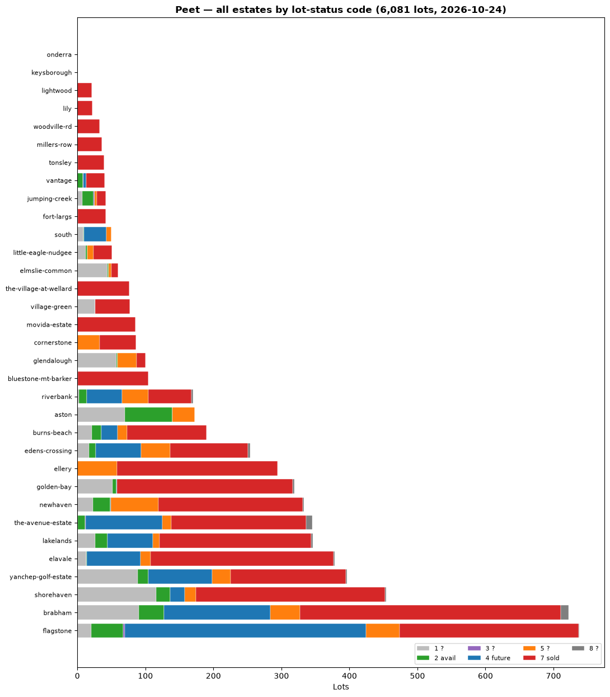
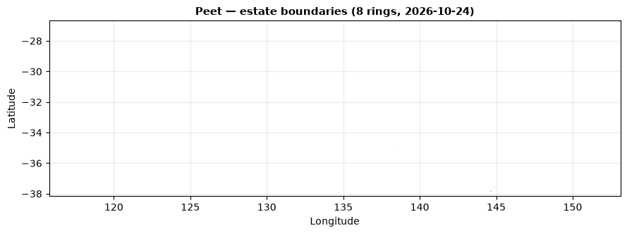

# deData-PPC-MasterplanDownloader (Peet Limited)

Weekly snapshotter for Peet community inventory — the same machine as SGP/CWP/LIC,
pointed at Peet's public `lotConfig` feed. No token, no auth, plain GET + parse.

## Why this exists
Peet publishes per-lot inventory on every community page: which lots exist, their
status codes, and the currently listed subset with price/frontage/size. Diffing
weekly snapshots yields net-sales velocity per estate — the same alternative-data
product as the SGP tracker, for a $992.5M Ingenia takeover target where settlement
momentum is genuinely price-relevant.

## Source
Each community page embeds:
```js
var lotConfig = {"lots_data":[...], "all_lots_with_status":[...], "mapConfig":{...}}
```
- `lots_data` — currently listed lots (lot_id, lot_name, stage, price, frontage, size, product_type)
- `all_lots_with_status` — every lot: lot_id, lot_number, lot_name, stage_name, `lot_status`, `lot_post_status` (`publish` = listed)
- `mapConfig.mapCoordinates` — estate boundary ring (when present)

Status codes, decoded behaviorally (firm up over 2–3 snapshots):
| code | meaning | evidence |
|---|---|---|
| 7 | sold / settled | sold-out estates read ~100% 7, zero published |
| 2 | available | every published lot is a 2 |
| 4 | future stages | clusters on newest stage names |
| 1 / 5 / 3 / 8 | mid-states (deposits, holds, staged releases) | watch transitions 4→2→7 |

## Discovery — no hardcoded IDs
Community paths are scraped live from `https://www.peet.com.au/communities/` on every
run, so new estates enter automatically. `discover_communities.py` diffs the live
index against the last snapshot and reports new/gone estates (no GCS, safe anywhere).

## Run it (local first)
```bash
cd function-PPC-masterplan-dl
TESTING=1 python3 ppc_downloader.py   # 2 communities → ./_outputfiles
python3 ppc_downloader.py             # all ~33 communities → ./_outputfiles
python3 render_charts.py              # rebuild charts/ from the latest full snapshot
python3 discover_communities.py       # index diff only
```
Filenames mirror SGP: `{ts}-ppc-website-masterplan-data-{slug}.json|.csv`.

CSV columns: date, company, community, lot_id, lot_number, lot_name, stage_name,
lot_status, lot_post_status, price, frontage, size, product_type, bedrooms,
bathrooms, garage_spaces (price/spec columns join from `lots_data` on lot_id;
empty unless the lot is currently listed).

## Live charts (latest snapshot)

Regenerated by `render_charts.py` after every snapshot run — what you see here is always the latest full pull.


*All estates by status code.* 

*Estate boundary rings.*

### Per-estate status (auto-updated every run)

<!-- ESTATE_TABLE:START -->
| Estate (click for card) | Lots | Listed | Sold 7 | Avail 2 · Fut 4 · Other |
|---|---|---|---|---|
| [flagstone](function-PPC-masterplan-dl/charts/estates/flagstone.png) | 738 | 14 | 263 (36%) | 2:47 4:354 5:50 1:20 |
| [brabham](function-PPC-masterplan-dl/charts/estates/brabham.png) | 722 | 35 | 384 (53%) | 2:37 4:157 5:43 1:90 |
| [shorehaven](function-PPC-masterplan-dl/charts/estates/shorehaven.png) | 455 | 19 | 278 (61%) | 2:20 4:22 5:16 1:116 |
| [yanchep-golf-estate](function-PPC-masterplan-dl/charts/estates/yanchep-golf-estate.png) | 396 | 9 | 170 (43%) | 2:15 4:94 5:27 1:89 |
| [elavale](function-PPC-masterplan-dl/charts/estates/elavale.png) | 378 | 1 | 269 (71%) | 2:1 4:79 5:15 1:13 |
| [lakelands](function-PPC-masterplan-dl/charts/estates/lakelands.png) | 346 | 12 | 223 (64%) | 2:18 4:67 5:10 1:26 |
| [the-avenue-estate](function-PPC-masterplan-dl/charts/estates/the-avenue-estate.png) | 345 | 5 | 198 (57%) | 2:10 4:113 5:13 1:1 |
| [newhaven](function-PPC-masterplan-dl/charts/estates/newhaven.png) | 336 | 18 | 212 (63%) | 2:25 4:1 5:70 1:23 |
| [golden-bay](function-PPC-masterplan-dl/charts/estates/golden-bay.png) | 320 | 0 | 259 (81%) | 2:5 4:1 5:0 1:52 |
| [ellery](function-PPC-masterplan-dl/charts/estates/ellery.png) | 294 | 0 | 236 (80%) | 2:0 4:0 5:58 1:0 |
| [edens-crossing](function-PPC-masterplan-dl/charts/estates/edens-crossing.png) | 254 | 3 | 115 (45%) | 2:10 4:67 5:42 1:17 |
| [burns-beach](function-PPC-masterplan-dl/charts/estates/burns-beach.png) | 190 | 14 | 117 (62%) | 2:14 4:24 5:14 1:21 |
| [aston](function-PPC-masterplan-dl/charts/estates/aston.png) | 173 | 17 | 0 (0%) | 2:70 4:0 5:33 1:70 |
| [riverbank](function-PPC-masterplan-dl/charts/estates/riverbank.png) | 170 | 8 | 64 (38%) | 2:12 4:52 5:38 1:2 |
| [bluestone-mt-barker](function-PPC-masterplan-dl/charts/estates/bluestone-mt-barker.png) | 104 | 0 | 103 (99%) | 2:0 4:0 5:0 1:1 |
| [glendalough](function-PPC-masterplan-dl/charts/estates/glendalough.png) | 100 | 2 | 13 (13%) | 2:2 4:0 5:28 1:57 |
| [cornerstone](function-PPC-masterplan-dl/charts/estates/cornerstone.png) | 86 | 0 | 53 (62%) | 2:0 4:0 5:33 1:0 |
| [movida-estate](function-PPC-masterplan-dl/charts/estates/movida-estate.png) | 85 | 0 | 85 (100%) | 2:0 4:0 5:0 1:0 |
| [village-green](function-PPC-masterplan-dl/charts/estates/village-green.png) | 77 | 0 | 51 (66%) | 2:0 4:0 5:0 1:26 |
| [the-village-at-wellard](function-PPC-masterplan-dl/charts/estates/the-village-at-wellard.png) | 76 | 0 | 76 (100%) | 2:0 4:0 5:0 1:0 |
| [elmslie-common](function-PPC-masterplan-dl/charts/estates/elmslie-common.png) | 60 | 0 | 10 (17%) | 2:2 4:0 5:4 1:44 |
| [little-eagle-nudgee](function-PPC-masterplan-dl/charts/estates/little-eagle-nudgee.png) | 51 | 3 | 27 (53%) | 2:3 4:0 5:9 1:12 |
| [south](function-PPC-masterplan-dl/charts/estates/south.png) | 50 | 0 | 0 (0%) | 2:1 4:33 5:7 1:9 |
| [fort-largs](function-PPC-masterplan-dl/charts/estates/fort-largs.png) | 42 | 1 | 41 (98%) | 2:1 4:0 5:0 1:0 |
| [jumping-creek](function-PPC-masterplan-dl/charts/estates/jumping-creek.png) | 42 | 13 | 13 (31%) | 2:17 4:0 5:4 1:7 |
| [vantage](function-PPC-masterplan-dl/charts/estates/vantage.png) | 40 | 0 | 27 (68%) | 2:8 4:4 5:0 1:0 |
| [tonsley](function-PPC-masterplan-dl/charts/estates/tonsley.png) | 39 | 0 | 38 (97%) | 2:0 4:0 5:0 1:1 |
| [millers-row](function-PPC-masterplan-dl/charts/estates/millers-row.png) | 36 | 0 | 36 (100%) | 2:0 4:0 5:0 1:0 |
| [woodville-rd](function-PPC-masterplan-dl/charts/estates/woodville-rd.png) | 33 | 0 | 33 (100%) | 2:0 4:0 5:0 1:0 |
| [lily](function-PPC-masterplan-dl/charts/estates/lily.png) | 22 | 0 | 22 (100%) | 2:0 4:0 5:0 1:0 |
| [lightwood](function-PPC-masterplan-dl/charts/estates/lightwood.png) | 21 | 0 | 21 (100%) | 2:0 4:0 5:0 1:0 |
| [keysborough](function-PPC-masterplan-dl/charts/estates/keysborough.png) | 0 | 0 | 0 (—) | 2:0 4:0 5:0 1:0 |
| [onderra](function-PPC-masterplan-dl/charts/estates/onderra.png) | 0 | 0 | 0 (—) | 2:0 4:0 5:0 1:0 |

*Snapshot 2026-10-24. Codes: 7 sold · 2 available · 4 future · 1/5/3/8 mid-states.*
<!-- ESTATE_TABLE:END -->

Full cards with boundary maps: [`function-PPC-masterplan-dl/charts/estates/`](function-PPC-masterplan-dl/charts/estates/)

## GCS (Cloud Run Job path)
`LOCAL=0 python3 ppc_downloader.py` writes to `ppc/masterplans/{json,csv}/`
(bucket `masterplans`) instead of disk. Needs ADC or a service-account key —
same IAM as the SGP job (storage.objectViewer + datastore.user on the target project).

Objects are stored **gzipped** (`*.json.gz`, `*.csv.gz`, `content-encoding: gzip`,
~7% of raw size). Local `_outputfiles/` stays plain JSON/CSV for readability.
Any future ETL must gunzip on read (`gzip.open(..., 'rt')`).

## Deploy
Cloud Run Job via `cloudbuild.yaml` (`ppc-masterplan-job`, 600s timeout for ~33 pages).
**CI/CD only — never deploy by hand.** Push to main; pipelines carry it.
Weekly schedule runs the job; downstream ETL/analysis consume `ppc/masterplans/`.
